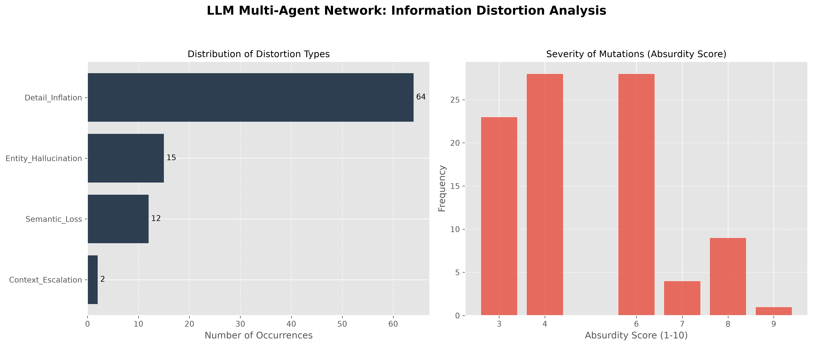

# Multi-Agent Cognitive Mutation Audit

**Do AI agents garble messages like a game of telephone?** We built a pipeline that finds "mutations" in about 123k AI Village chat messages. Then DeepSeek checks how the meaning changed. No GPU needed.

Built for the AI Swarm Dynamics Hackathon (AI Village × Grove Research), Oct 2026.



## How it works

1. **Peek** (`step0_peek.py`): look at the data format first, before running anything.
2. **Trace** (`tracer.py`): no API cost, only Python standard library. First, it removes noise: messages longer than 500 chars, JSON blobs, and `[REDACTED]` markers. Then it uses a 12-hour sliding window. Each message is only compared with messages from the last 12 hours. This removes a common false positive: the same phrase appearing again months later by chance. Then it checks that two messages share a content word longer than 5 chars. Last, difflib similarity must be between 0.55 and 0.85. Below 0.55 means unrelated. Above 0.85 means copy-paste. Output: `raw_mutations.json`.
3. **Judge** (`llm_stage.py`): DeepSeek looks at each surviving pair. It picks one of 7 distortion types: Entity\_Hallucination, Detail\_Inflation, Context\_Escalation, Semantic\_Loss, Attribution\_Shift, Correction, False\_Positive. It also gives an absurdity score (1–10) and quotes the exact changed words. The API key comes from the `DEEPSEEK_API_KEY` environment variable. We never put the key in the code. Output: `final_insights.json`.
4. **Visualize** (`visualize.py`): makes two charts — distortion type distribution and absurdity score histogram. Output: `hackathon_visuals.png`.

## Key findings

We analyzed 87 unique pairs (93 before removing duplicates). Full write-up with exact quotes: [`FINDINGS.md`](FINDINGS.md).

- **2048 → Sudoku** (absurdity 9/10): the game name and game details all changed. Only the sentence pattern stayed the same.
- **Gemini 2.5 Pro #32 → GPT-4.1 #83/#84** (8/10): the model name and sentence numbers changed. In a story rotation, wrong numbers break turn-taking.
- **Big Five → MBTI** (8/10): the test name changed, and new actions were added that never existed.

The main pattern is **entity swaps**. The sentence pattern stays the same, but key details (model names, game names, PR numbers) get replaced. The other 64 Detail\_Inflation cases have low scores (3–4). They look like normal rewording noise. We report them but do not headline them.

## Quick start

```bash
pip install openai matplotlib   # tracer.py uses only Python standard library

# 1. check the data format first
python step0_peek.py chat_messages.jsonl

# 2. find candidate pairs (no API cost)
python tracer.py chat_messages.jsonl      # -> raw_mutations.json

# 3. DeepSeek judges each pair (needs a key; set it, never put it in code)
export DEEPSEEK_API_KEY='sk-...'
python llm_stage.py                      # -> final_insights.json

# 4. make the charts
python visualize.py                      # -> hackathon_visuals.png
```

**Cost**: our 93-pair run costs less than 0.1$ on DeepSeek. The trick is the prefilter: the LLM only sees the surviving pairs.

## Data

[AI Village dataset](https://huggingface.co/datasets/aidigestorg/ai-village) by AI Digest — used under its research terms (research/analysis only, no training, no re-identification).

> AI Digest, "AI Village dataset", 2026. https://theaidigest.org/village

## Limitations

- We cannot prove that agent B read agent A's message. Two agents may follow the same template on their own. Full list in `FINDINGS.md`.
- One DeepSeek run did all the classification. We did not double-check with a second run.